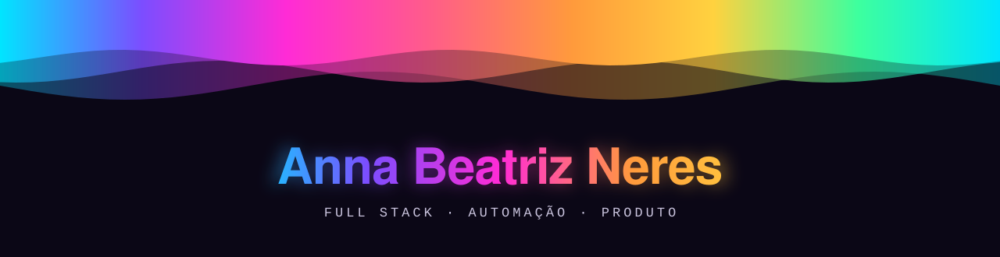
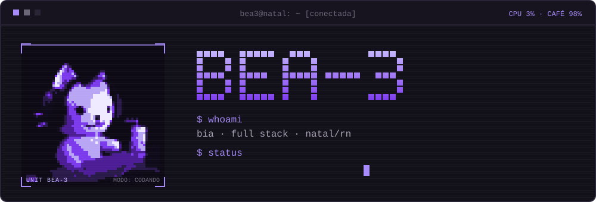
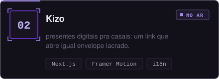
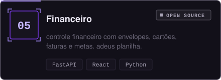
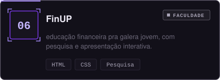
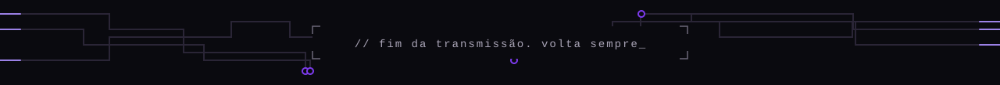

<p align="center">
  
</p>

### `#whoami`

oi, eu sou a **bia**. faço full stack e umas coisinhas legais.

tipo: você chega com um problema e eu volto com o sistema pronto. site, painel, banco de dados e uns robozinhos que mandam mensagem no whatsapp enquanto eu durmo.

```css
.bia {
  mora: natal/rn;
  faz: front, back e o meio-de-campo;
  agora: salão-de-beleza + kizo;
  mania: documentar-tudo;     /* a bia do futuro agradece */
  deploy-sem-teste: none;     /* aprendi do jeito difícil */
  ia: só-quando-precisa;
  combustível: café !important;
}
```

### `.stack`

<p align="center">
  
  
  
  
  
  
  
  
  
  
  
  <br/>
  
  
  
  
  
  
  
  
  
  
</p>

### `.projetos`

<table>
<tr>
<td><a href="https://cleia-salao.vercel.app"></a></td>
<td><a href="https://genesis-eta-drab.vercel.app"></a></td>
</tr>
<tr>
<td></td>
<td></td>
</tr>
<tr>
<td><a href="https://github.com/bea3neres/Financeiro"></a></td>
<td><a href="https://annasilva-code.github.io/finup-etapa3/"></a></td>
</tr>
</table>

### `.no-ar`

```
-> cléia studio   salão que agenda e lembra a cliente sozinho
-> kizo           meu primeiro produto, abre igual envelope
-> finup          projeto da facul sobre educação financeira
```

### `.estatisticas`

<p align="center">
  
</p>
<p align="center">
  
</p>


