  

## 👾 whoami

<table>
<tr>
<td width="64%" valign="top">

Oi! Eu sou a **Anna** (ou **Bea**), desenvolvedora **full stack** em Natal/RN 🌵

Eu construo **sistemas completos para negócios de verdade**: o site que a cliente vê, o painel que a dona usa todo dia, o banco por trás e as automações que trabalham sozinhas, como lembretes no WhatsApp e leitura de nota fiscal por IA.

- 🔭 Agora: **Cléia Studio**, a plataforma de agendamento de um salão, e **Kizo**, presentes digitais para casais
- 📖 Documento tudo: README desatualizado, para mim, é bug
- 🧪 Nada vai para o ar sem teste, e o banco de teste fica separado do de produção
- 🤖 Uso IA onde ela agrega, e regra simples onde ela resolve

</td>
<td width="36%" align="center">

</td>
</tr>
</table>

## 🛠️ stack

  
  
  
  
  
  
  
  
  
  
  
   
  
  
  
  
  
  
  
  
  
  

## 🚀 projetos

<table>
<tr>
<td></td>
<td></td>
</tr>
<tr>
<td></td>
<td></td>
</tr>
<tr>
<td></td>
<td></td>
</tr>
</table>

## 📈 stats

  

  
  

  

## 🏆 no ar

- ✂️ **Cléia Studio**: agendamento online, painel da dona e WhatsApp automático rodando para um salão de verdade
- 💌 **Kizo**: meu primeiro produto próprio, em 3 idiomas, com 4 estilos de presente
- 🎓 **FinUP**: pesquisa e plataforma de educação financeira para jovens

<h3 align="center">obrigada pela visita ✨</h3>

